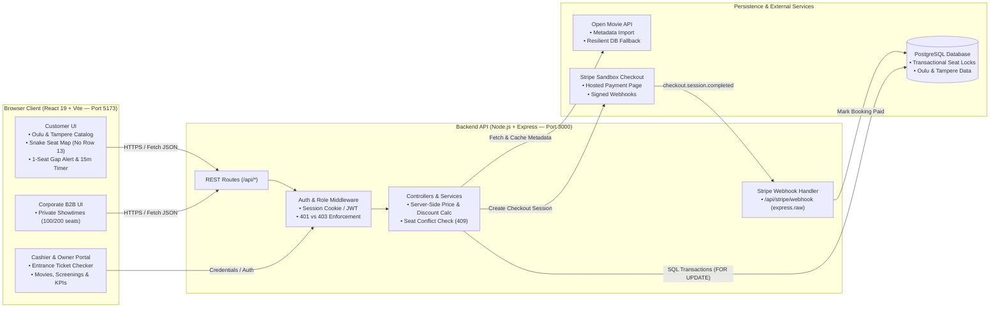
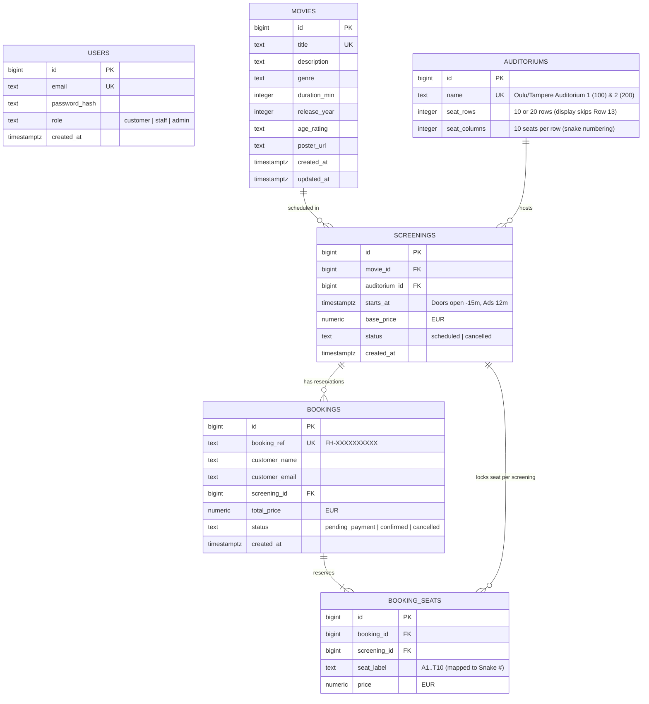

# Cinema RIO (FilmHall) — System Architecture & Database ERD

## 1. Architecture Overview
**Cinema RIO (FilmHall)** follows a three-tier layered web architecture connecting a **React + Vite** Single Page Application (`client/`), a **Node.js + Express** REST API (`server/`), and a **PostgreSQL** relational database (`database/`), with external integrations for **Stripe Hosted Checkout** (online ticket payments) and an **Open Movie API** (with local database fallback so ticket sales never stop if the external API is unreachable).

### System Architecture Diagram

---

## 2. Trust Boundary & Security Principles
Following the course Authentication, Authorization, and Stripe Payment guidelines:
1. **"The UI guides. The server decides."**
   - Conditional rendering in React improves usability for Customers, Cashiers, and Owners, but every protected route in `server/` independently enforces authentication (`401 Unauthorized`) and role authorization (`403 Forbidden`).
2. **Server-Side Pricing & Seat Integrity**:
   - The server never trusts ticket prices sent from the browser. Prices and discounts (+15% tier, 50% Child ≤12 discount, 50% Member 10-ticket bundle) are verified against the screening's `base_price`.
   - PostgreSQL row-level locking (`SELECT ... FOR UPDATE`) prevents two customers from booking the same seat concurrently (`HTTP 409 Conflict`).
3. **Resilient Continuity**:
   - If the external Open Movie API is unavailable, the application serves cached/seeded movies from PostgreSQL and local fallback state so Cinema RIO customers can continue buying tickets without interruption.

---

## 3. Database Schema — Entity-Relationship Diagram (ERD)

---

## 4. Directory Structure
- **`client/`** — React 19 + Vite frontend application:
  - `src/data/rioCinemaData.js` — Cinema RIO Oulu & Tampere locations, auditorium specs, showtime rules, and resilient fallback catalog.
  - `src/utils/seatRules.js` — Snake seat numbering (skipping Row 13 and Seat #13), Row 1 wheelchair mapping, single-seat gap detection, guided seat suggestions, and showtime timeline helpers.
  - `src/components/SeatMap.jsx` — Interactive Cinema RIO Auditorium Seat Map with front screen, dual rear entrances, 15:00 hold timer, and orphan-seat auto-fix.
  - `src/components/CorporateBookingSection.jsx` — B2B corporate private screening request form.
  - `src/pages/HomePage.jsx` — Customer, Cashier, and Owner workspaces.
- **`server/`** — Express REST API (`routes/`, `controllers/`, `middleware/`, `services/`, `tests/`).
- **`database/`** — PostgreSQL schema migrations (`migrations/001_init.sql`, `002_movie_release_year.sql`) and demo seed scripts (`seeds/001_demo_data.sql`).
- **`docs/`** — Requirements engineering, product backlog, sprint planning workbook log, and Git workflow.
